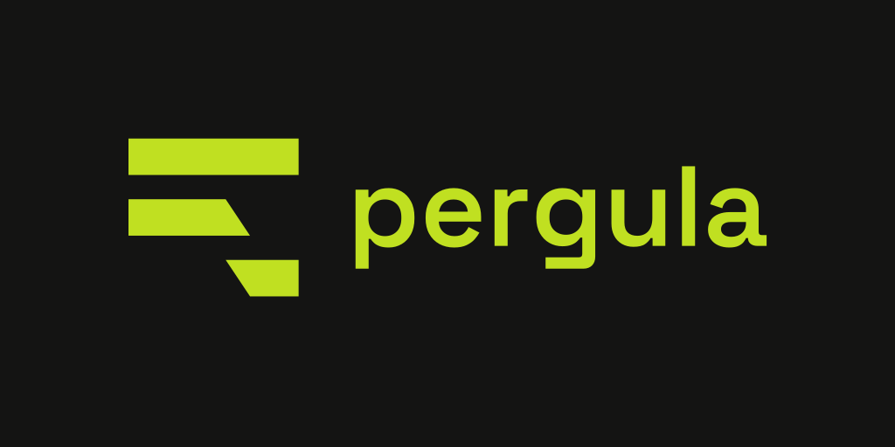
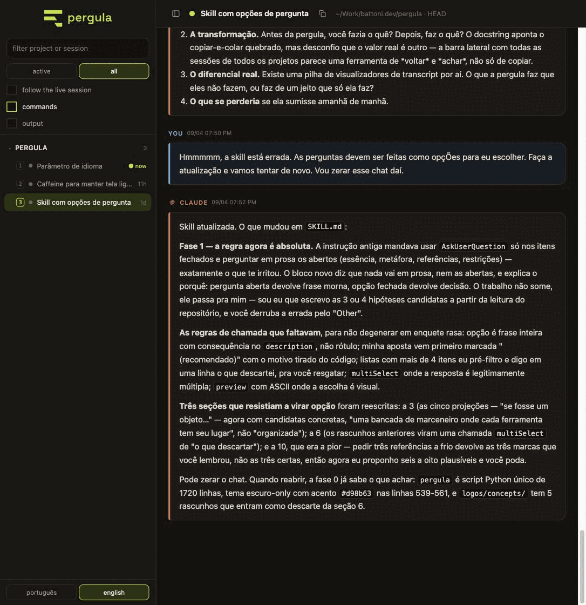
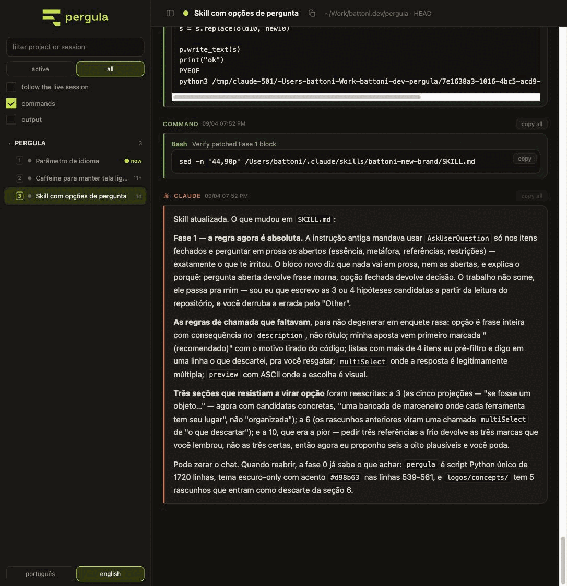

A local, dependency-free web reader for Claude Code transcripts.

**[Try it in the browser →](https://battoni.github.io/pergula/)** — the real interface over made-up sessions, every shortcut working.

## The problem

The terminal renders Claude's prose hard-wrapped. Select it with the mouse and
you get real newlines inside every paragraph — so what looked like prose arrives
in your email or your issue tracker shattered.

It looks like text. It is not text.

pergula serves the same transcripts as a plain web page on `127.0.0.1`, where
text selects the way text is supposed to select and every code block has a copy
button.



## Install

```sh
curl -fsSLO https://raw.githubusercontent.com/battoni/pergula/main/pergula
chmod +x pergula
./pergula --install
```

`--install` registers a launch agent that runs at login and restarts if it dies.
After that, running `pergula` from any terminal opens the window.

Nothing else is required. One file, the Python standard library, no build step.

## Use

```
pergula              open the window; serve first if nothing is listening
pergula --serve      always serve in the foreground, never just open
pergula --install    run at login as a background agent, restarted if it dies
pergula --uninstall  remove that agent
pergula --status     say whether anything is listening
pergula --port 8080  any of the above, somewhere else
pergula --here       only list sessions from the current directory
```

Default port is `7373`.

## Keyboard

Moving between sessions takes no time: a click, or `cmd` and the row's number.
The last few you read are painted from memory while the server confirms them.



| | |
| --- | --- |
| `cmd/ctrl + K` | open the snippet palette, from anywhere |
| `cmd/ctrl + B` | hide or show the session list |
| `cmd/ctrl + F` | focus the filter |
| `cmd/ctrl + A`, then `F` | focus: only the open session's project on the list; again to leave |
| `cmd/ctrl + 1` … `9` | jump to the nth row on the list, in the order shown |
| `cmd/ctrl + S` | save the open snippet |
| `esc` in the filter | clear it and let go of it |
| `enter` / `esc` while renaming | keep the project name, or discard it |
| `↑` `↓` `enter` `esc` in the palette | pick one, copy it, or leave |

Both modifiers are bound on purpose. In an ordinary Chrome tab `cmd+1` belongs to
the tab strip and never reaches the page; only the window pergula opens for
itself is free of that, so `ctrl` is there for everyone else.

Renaming a project starts on a double-click on its name, or on the pencil that
appears when you hover it. Sessions reorder by dragging, and the order is
remembered per project.

Every code block has a copy button, and each message has `copy all`. Both appear
on hover, so they are never in the way of reading.



### Focus on one project

When there is one project you should be working on, `cmd+A` then `cmd+F` takes
every other one off the list. The open session's project stays, with any project
in a folder under it, until the same keys or a click on the chip bring the rest
back. It is remembered, so a reload does not undo it.



### Picking a session back up

A session left alone for a few hours has lost its prompt cache, and the next
message in it pays for the whole context again. The arrow beside the session id
in the header copies a prompt for a new session instead: the title, the id, the
project, where the transcript is, and the last few turns — without the
commands and their output, which is where the size of a transcript goes. Paste it
into a fresh `claude` and it starts from a page of text rather than from
everything.



## What it shows

A sidebar groups every session by project. Sessions carry the name and the colour
you gave them with `/rename` and `/color`, because the CLI writes both into the
transcript. **active** sessions are the ones with a Claude process open in a
terminal right now — read from the CLI's own per-pid registry in `~/.claude/sessions`, not
guessed from the process table.

Each active session carries a light for what it is doing: blue working, green
ready, orange **needs you** (a permission, a question, a plan to approve) and red
when the turn failed. The last two replace the time on the row, and their count
goes into the window title and onto the Dock icon when pergula runs as an
installed app. The registry only knows busy and idle; the other two come from
the files the tab-status hooks write in `~/.claude/tab-status/sessions`, the
same hooks that put the state in the terminal tab title. Without them the light
falls back to the registry's two.

A turn can end with subagents still running in the background. The row stays
blue until the last one finishes, with their count where the time would be.
A turn that ends waiting on a shell it started (a CI watch, a build) turns
purple, **waiting on a shell**, until the shell finishes and the agent wakes;
shells that never finish on their own, like a dev server, do not count.



Whatever you are reading stays on the list regardless, so it never vanishes under
you mid-sentence. The page never scrolls itself while text is selected.

Inside a project the sessions fall under the day they were last touched — today,
yesterday, the last 7 days, the last 30, older — and the headings only appear when
a project spans more than one. Dragging still reorders, within a day.

The **view** block and the favourites each fold down to their heading, for when
the list needs the room. Folded, **view** still says whether you are looking at
active sessions or all of them.

Project nicknames live in `~/.claude/pergula-names.json`, next to the transcripts
they rename, so they survive reinstalls and are trivial to inspect or delete by
hand.

## Snippets

The prompts you send every day are not worth a skill and are tiring to retype.
The **library** tab keeps them, and `cmd+K` puts one on the clipboard from
anywhere in the app — type a few letters, press enter, paste. No pointer
involved, no view change, no leaving the transcript you were reading.



The prompts worth keeping are usually already in a transcript, so every turn of
your own carries a `keep` button on hover: it promotes that message into the
library with the text filled in and the cursor on the title.

They are stored as ordinary Markdown, one file per snippet, under
`~/.claude/pergula-snippets/`:

```
~/.claude/pergula-snippets/
  commit-message.md
  review/pr.md
  review/security.md
```

One folder deep, and the folder is the group. The first line is a `# heading`
that names it and never travels to the clipboard; everything below is the prompt,
verbatim. Which means the library is `grep`-able, editable in your own editor,
versionable in git, and syncable — nothing about it depends on this program.

Typing writes the file after a short pause, so there is no unsaved state to lose;
retitling moves the file and takes the old one with it.

### Favourites

Five of them can be starred, and those five sit in their own block at the top of
the session list — visible while you read, one click to copy. That is the whole
interaction: no view change, no palette, no keyboard. The star lives on the
button beside `copy` in the editor, and goes dim once five are taken.

The list is `~/.claude/pergula-favourites.json`, an ordered array of slugs. It
follows a retitle and forgets a deleted snippet, and a star pointing at a file
you removed by hand simply stops appearing.

## Keeping the Mac awake

An agent left working stops when the machine sleeps, which is a poor way to find
out that it was never finished. The button at the bottom of the sidebar holds
sleep off for one, two, four or eight hours, and shows what is left of that time
while it does.



It is `caffeinate -disu -t` and nothing more — the tool that ships with macOS.
The `-i` is the one that matters: it holds off the idle sleep that would stop the
agents. The `-d` keeps the display up as well, which is what makes it visible
that something is holding the machine.

Clicking it again lets the Mac sleep. So does the deadline running out, and so
does `make deploy`, which restarts the agent and takes the child process with it.
There is no way to leave it on by accident and no way to leave it on forever.

## The name

*Pergula* is Latin for the light frame of beams that throws a roof out from the
wall of a house — a porch. A covered place **outside** the building, from which
you look back at what happened inside.

That is the product in one word. The work happened in the terminal; this is
where you stand to read it. It is not another room of the house, and it changes
nothing indoors — it only gives you somewhere to sit and look back.

## What it does not do

It never writes a byte back to a transcript, and never sends one anywhere. It
reads them.

The only things it writes are yours: project nicknames, the snippet library and
the caffeinate deadline, all plain files under `~/.claude/`, all readable,
editable and deletable without this program.

Nothing leaves the machine — no account, no sync, no telemetry, no network call
of any kind. Even the Claude mark in the interface is drawn in JavaScript rather
than fetched, so the page makes no request at all.

The `127.0.0.1` binding is deliberate.

## Requirements

macOS, Python 3, and Claude Code writing transcripts to `~/.claude/projects`.

The launch agent runs under `/usr/bin/python3` rather than whatever pyenv happens
to be shimming, so it survives a version switch it knows nothing about. Its log
is at `~/Library/Logs/pergula.log`.

## Licence

MIT — see [`LICENSE`](LICENSE).

The brand is a different matter: the mark and the wordmark identify pergula, and
the licence covers the code, not the identity. Fork the tool freely; give your
fork its own name and its own mark.

## Brand

The mark is a paragraph with a line snapped in two, the tail fallen below — a
picture of the break this exists to fix. [`brand/`](brand/) holds the reasoning,
starting with [`brand/concept.md`](brand/concept.md).
